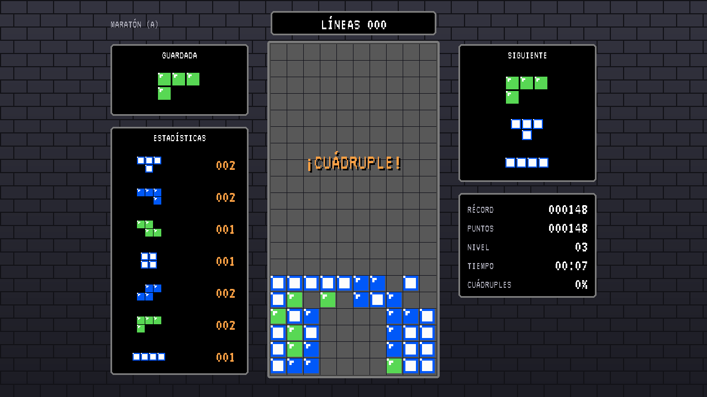
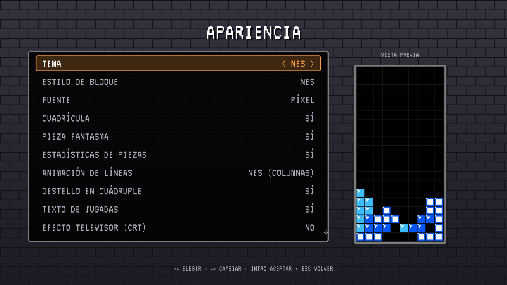
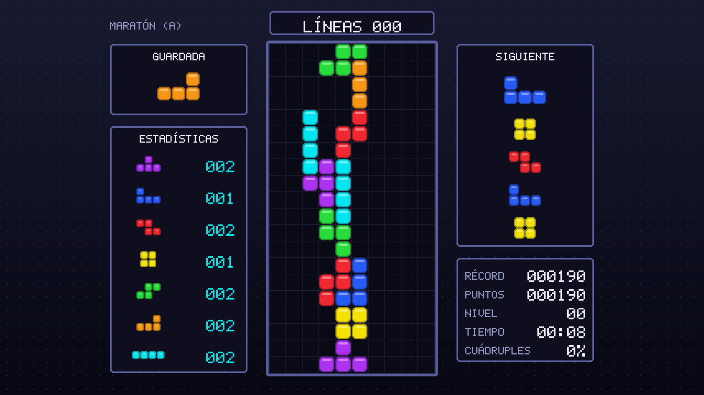
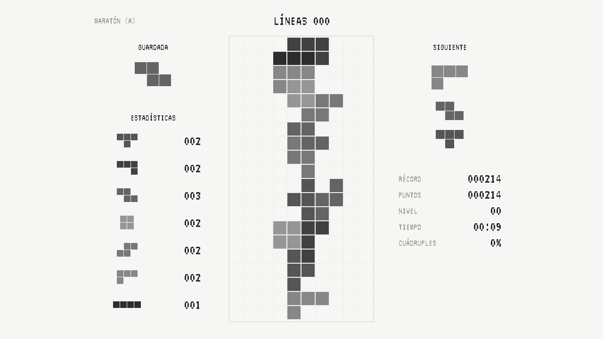
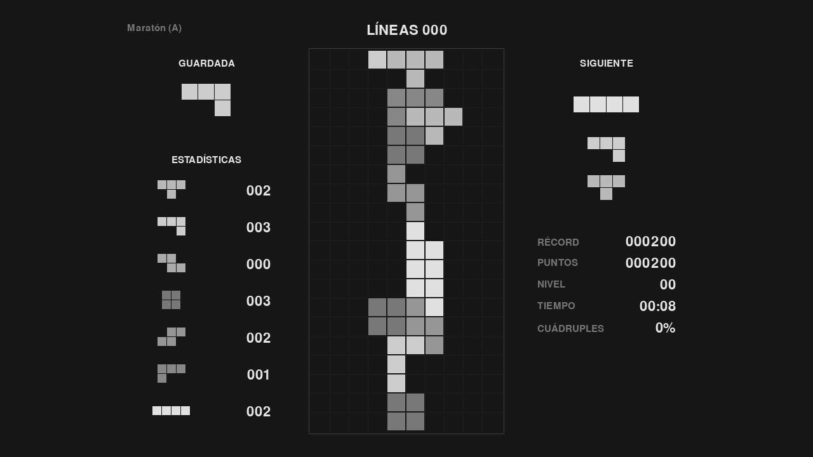

# Quadrafall

Juego libre de bloques que caen, inspirado en **Quadrapassel** (GNOME) y en las reglas del
clásico de **NES**, con mejoras modernas opcionales: guardar pieza, varias piezas siguientes,
caída instantánea y pieza fantasma. Funciona en **Windows y Linux**.



## Descargar

### [⬇ Descargar la última versión](https://github.com/Alexvb99/quadrafall/releases/latest)

| Sistema | Archivo que debes descargar | Cómo instalarlo |
|---|---|---|
| **Windows 10/11** | `Quadrafall-<versión>-Windows-Setup.exe` | Ábrelo y sigue el asistente (no pide permisos de administrador). |
| **Linux** (cualquier distribución) | `Quadrafall-<versión>-Linux-x86_64.AppImage` | *Propiedades → Permitir ejecutar como programa* y ábrelo. |
| **Ubuntu / Debian / Mint** | `quadrafall_<versión>_amd64.deb` | Ábrelo con el instalador de software o `sudo apt install ./quadrafall_<versión>_amd64.deb`. |
| **Arch Linux / CachyOS / Manjaro / EndeavourOS** | `quadrafall-bin-<versión>-1-x86_64.pkg.tar.zst` | `sudo pacman -U ./quadrafall-bin-<versión>-1-x86_64.pkg.tar.zst` (detalles abajo). |

El instalador de Windows no está firmado digitalmente: si aparece «Windows protegió su PC»,
pulsa **Más información → Ejecutar de todas formas**. También hay versiones portátiles
(`.zip` para Windows y `.tar.gz` para Linux) que no necesitan instalación.

### Arch Linux y derivadas (pacman)

El paquete `quadrafall-bin` instala el juego en `/opt/quadrafall`, con el comando `quadrafall`,
entrada en el menú de aplicaciones e icono. Hay dos formas de instalarlo:

**Con el paquete ya hecho** (descárgalo de la [última versión](https://github.com/Alexvb99/quadrafall/releases/latest)):

```sh
sudo pacman -U ./quadrafall-bin-<versión>-1-x86_64.pkg.tar.zst
```

**O construyéndolo con el `PKGBUILD`** (también está en la versión; comprueba las sumas sha256
de lo que descarga):

```sh
sudo pacman -S --needed base-devel
mkdir quadrafall && cd quadrafall
curl -LO https://github.com/Alexvb99/quadrafall/releases/latest/download/PKGBUILD
makepkg -si
```

- **Actualizar:** repite cualquiera de los dos pasos con la versión nueva.
- **Desinstalar:** `sudo pacman -R quadrafall-bin` (los ajustes y récords de `~/.config/quadrafall`
  y `~/.local/share/quadrafall` se conservan).
- El juego usa X11 (en Wayland funciona a través de XWayland).

## Características

- **Reglas del NES**: velocidades por nivel (48 → 1 fotogramas por fila), puntuación
  40/100/300/1200 × (nivel + 1), progresión de niveles, DAS 16/6, retardo de aparición
  variable, animación de borrado por columnas y estadísticas de piezas.
- **Mejoras modernas** (todas opcionales): guardar pieza, 0–5 piezas siguientes, caída
  instantánea, pieza fantasma, margen mínimo para fijar la pieza, rotación con ayudas o SRS
  y bolsa de 7.
- **Tres estilos predefinidos**: *NES clásico*, *NES+* (recomendado: como el NES, pero con al
  menos 1/3 s para colar la pieza en un hueco aunque bajes rápido) y *Moderno*. Cualquier
  ajuste se puede cambiar por separado.
- **Se pierde** cuando una pieza aparece sobre otra o cuando, al fijarse, algún bloque queda
  por encima del límite (por ejemplo, una I girada en el último momento).
- **Modos**: Maratón (A), 25 líneas (B) y Sprint de 40 líneas.
- **Filas prellenadas** con densidad configurable, como en Quadrapassel.
- **Personalización visual**: 8 temas (NES con colores por nivel, Clásico Tango, Neón,
  Portátil verde, Pastel, Minimalista claro y oscuro, y apto para daltonismo), 5 estilos de bloque,
  3 fuentes (píxel de terminal *VT323* por defecto, redondeada *Varela Round* y lisa),
  cuadrícula, animaciones, efecto CRT y vista previa en directo.
- **Controles reasignables**: dos teclas y un botón de mando por acción. Mandos con cruceta o palanca.
- **Sonido 8 bits generado por código** y música (*Korobeiniki*, canción popular de dominio público).
- **Récords** locales por modo, **español e inglés**, ventana de cualquier tamaño (el juego se escala y se centra), pantalla completa (F11) y modo portátil.

| | |
|---|---|
|  |  |
|  |  |

## Controles por defecto

| Acción | Teclado | Alternativa | Mando |
|---|---|---|---|
| Mover | ← → | A D | Cruceta / palanca |
| Bajar | ↓ | S | Cruceta ↓ |
| Caída instantánea | Espacio | W | Cruceta ↑ |
| Girar a la derecha | X | ↑ | Botón 2 (B) |
| Girar a la izquierda | Z | Ctrl izq. | Botón 1 (A) |
| Guardar pieza | C | Mayús izq. | Botón 3 (X) |
| Pausa | Esc | P | Botón 8 (Start) |
| Pantalla completa | F11 / Alt+Intro | | |

## Jugar desde el código fuente

Necesitas Python 3.10 o superior.

**Windows (PowerShell):**

```powershell
python -m venv .venv
.venv\Scripts\python -m pip install -e .
.venv\Scripts\python -m quadrafall
```

**Linux:**

```sh
python3 -m venv .venv
.venv/bin/pip install -e .
.venv/bin/python -m quadrafall
```

Pruebas del motor: `pip install -e ".[dev]"` y después `python -m pytest`.

## Crear los instaladores

| Plataforma | Comando | Resultado en `dist/` |
|---|---|---|
| Windows | `powershell -ExecutionPolicy Bypass -File packaging\windows\build.ps1` | `Quadrafall-<versión>-Windows-Setup.exe` (requiere [Inno Setup 6](https://jrsoftware.org/isinfo.php)) y `Quadrafall-<versión>-Windows-Portable.zip` |
| Linux | `sh packaging/linux/build.sh` | `Quadrafall-<versión>-Linux-x86_64.AppImage` (requiere [appimagetool](https://github.com/AppImage/appimagetool)), `quadrafall_<versión>_amd64.deb` y `.tar.gz` |
| Arch Linux | `sh packaging/arch/build.sh <versión>` (después de `packaging/linux/build.sh`, en Arch con `base-devel` y `pacman-contrib`) | `quadrafall-bin-<versión>-1-x86_64.pkg.tar.zst` y su `PKGBUILD` |
| Linux (Flatpak) | Ver las instrucciones dentro de `packaging/linux/io.github.alexvb99.Quadrafall.yml` | Paquete para Flathub |

PyInstaller no compila de forma cruzada: lo de Windows se hace en Windows y lo de Linux en
Linux. En GitHub lo hace solo el flujo `.github/workflows/build.yml` en cada *push*.

**Publicar una versión nueva:** sube el número en `src/quadrafall/__init__.py` (`__version__`)
y en `packaging/linux/io.github.alexvb99.Quadrafall.metainfo.xml`, haz commit y crea la
etiqueta: `git tag v0.2.0` y `git push origin v0.2.0`. GitHub compila los instaladores (también el paquete de Arch,
con `pkgver` y las sumas actualizadas en su `PKGBUILD`) y
publica la versión con las notas de `packaging/RELEASE_NOTES.md`.

## Dónde se guardan los datos

| Sistema | Ajustes | Récords |
|---|---|---|
| Windows | `%APPDATA%\Quadrafall\settings.json` | `%APPDATA%\Quadrafall\scores.json` |
| Linux | `~/.config/quadrafall/settings.json` | `~/.local/share/quadrafall/scores.json` |
| Modo portátil | carpeta `data` junto al ejecutable | ídem |

Para el **modo portátil**, crea un archivo vacío `portable.txt` junto a `Quadrafall.exe`.

## Estructura del proyecto

```
src/quadrafall/
  engine/        Reglas del juego, sin pygame (pieces, randomizer, board, game)
  ui/            Dibujo, menús, entrada, temas y fuentes
  assets/fonts/  Fuentes incluidas (VT323 y Varela Round) con sus licencias OFL
  app.py         Ventana, bucle a 60 Hz y pila de escenas
  settings.py    Ajustes y estilos predefinidos (NES, NES+, Moderno)
  i18n.py        Textos en español e inglés
  audio.py       Efectos y música sintetizados
tests/           Pruebas del motor (pytest)
packaging/       PyInstaller, instalador de Windows, .desktop, AppStream, Flatpak y PKGBUILD de Arch
tools/           Generador del icono
```

- **Añadir un tema**: una entrada nueva en `THEMES` (`ui/themes.py`) y su nombre en `i18n.py` (`theme_<clave>`).
- **Añadir un idioma**: su código en `LANGUAGES` y una columna más en `STRINGS` (`i18n.py`).
- **Cambiar el nombre del juego**: `APP_NAME` en `src/quadrafall/__init__.py`.
- **Añadir un estilo de juego**: una entrada en `PRESETS` (`settings.py`).
- **Añadir una fuente**: el `.ttf` y su licencia en `assets/fonts`, una entrada en `FONTS`
  (`ui/font.py`) y su nombre en `i18n.py` (`font_<clave>`). Solo fuentes libres (p. ej. OFL).

## Licencia

Quadrafall es software libre bajo la licencia **GNU GPL versión 3 o posterior**
(`GPL-3.0-or-later`); consulta [LICENSE](LICENSE). Es compatible con la licencia de
Quadrapassel (GPL-2.0-or-later), aunque este proyecto es una reimplementación desde cero y
no incluye código ni recursos de Quadrapassel.

Todos los gráficos y sonidos se generan por código en este repositorio. La melodía
*Korobeiniki* es una canción popular rusa del siglo XIX de dominio público; el arreglo es propio.

Las fuentes [VT323](https://fonts.google.com/specimen/VT323) (© The VT323 Project Authors) y
[Varela Round](https://fonts.google.com/specimen/Varela+Round) (© The Varela Round Project Authors)
se distribuyen sin modificar bajo la licencia SIL Open Font License 1.1; sus textos están en
`src/quadrafall/assets/fonts/`.

Este proyecto no está afiliado a The Tetris Company ni a GNOME. «Tetris» es una marca
registrada de The Tetris Company; por eso el juego no usa ese nombre.
